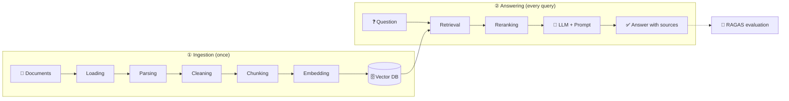

<div align="center">

# 🧠 RAG: From Zero to Advanced

### A free, open-source, hands-on course on building, measuring, and improving Retrieval-Augmented Generation systems

**Learn it. Code it. Measure it. Improve it.**

[](https://github.com/HosseinHeydari2004/RAG-Tutorial-From-Zero-to-Advanced/stargazers)
[](https://github.com/HosseinHeydari2004/RAG-Tutorial-From-Zero-to-Advanced/network/members)
[](LICENSE)
[](https://www.python.org/)
[](CONTRIBUTING.md)

**🇬🇧 English** | [🇮🇷 فارسی](https://github.com/HosseinHeydari2004/RAG-Tutorial-From-Zero-to-Advanced/blob/main/REAMME.md)

[Quick Start](#-quick-start) •
[Lessons](#-lessons) •
[Roadmap](#-roadmap) •
[Contributing](#-contributing)

</div>

---

## 🤔 What is this?

Large language models (LLMs) don't know what happened after their training cutoff, can't see your private documents, and sometimes **confidently make things up** (hallucination).

**Retrieval-Augmented Generation (RAG)** fixes this: before answering, we find the most relevant parts of your documents and hand them to the model along with the question.

This repo is a complete path, from "what is RAG?" to "an evaluated, deployable system". Every lesson is a notebook you **run right there and see the result**.

```text
Question: "How many PTO days do I get after two years?"

Without RAG → "Usually 10 to 20 days..."                  ❌ a guess
With RAG    → "15 days/year (1–3 years of service)"      ✅ cited from the document
```

> This example comes from the course itself: the project is built around an "Employee Handbook" and grows lesson by lesson into a full system. The output above illustrates the idea; you'll see the real output in the lessons.

---

## ✨ Why this course?

| | |
|---|---|
| 🇮🇷 **Persian-first** | Lessons are written in Persian with code and terms kept in English, just like real-world work. Persian-specific text challenges (normalization, ZWNJ, multilingual embeddings) are covered too. This README is the English entry point. |
| 📏 **Measure first, then optimize** | The evaluation module (with RAGAS) comes *before* the tuning lessons. Every change, such as chunk size or a reranker, is judged by numbers, not gut feeling. |
| 🧩 **One growing project** | Not ten unrelated demos. One system, from the first PDF to deployment. |
| ⚡ **20 lines to a first answer** | Lesson 00 is a tiny but complete RAG. You see the result first, then we open the box. |
| 🆓 **A free path** | The goal is for every LLM-based lesson to have a free, local option, so lacking a paid API never blocks learning. |
| 🔁 **Runs on a clean machine** | Library versions are pinned and every lesson is designed to run on Colab. |

---

## 🗺️ The big picture



---

## 🚀 Quick Start

### Option 1: No install, on Colab
Click the **Open in Colab** button of the lesson you want in the table below.

### Option 2: On your machine

```bash
# 1) Clone
git clone https://github.com/HosseinHeydari2004/RAG-Tutorial-From-Zero-to-Advanced.git
cd RAG-Tutorial-From-Zero-to-Advanced

# 2) Virtual environment
python -m venv .venv
source .venv/bin/activate        # Windows: .venv\Scripts\activate

# 3) Install
pip install -r requirements.txt

# 4) Run
jupyter lab
```

> 🔑 **API keys** are never stored in notebooks or in the repo. Lessons that need one ask you for it via `getpass` or an environment variable.

---

## 📚 Lessons

**Status legend:** ✅ ready • 🚧 in progress / being rewritten • 📅 planned

### Level 0: Getting started

| # | Lesson | What you build | Status |
|:-:|---|---|:-:|
| 00 | RAG in 20 lines | Your first answer grounded in external knowledge | 📅 |
| 01 | Core concepts | Hallucination, context window, RAG vs. fine-tuning | 📅 |

### Level 1: Data ingestion

| # | Lesson | What you build | Status |
|:-:|---|---|:-:|
| 02 | [Loading](notebooks/02_loading.ipynb) | Read PDFs and files into a uniform structure | 🚧 |
| 03 | [Parsing](notebooks/03_parsing.ipynb) | Extract structure: titles, tables, lists | 🚧 |
| 04 | [Cleaning](notebooks/04_cleaning.ipynb) | Remove noise and normalize text | 🚧 |
| 05 | [Metadata](notebooks/05_metadata.ipynb) | Tag content for filtering and citations | 🚧 |
| 06 | [Chunking](notebooks/06_chunking.ipynb) | Fixed, Recursive, Token, Semantic, Document-based | 🚧 |

### Level 2: The RAG core

| # | Lesson | What you build | Status |
|:-:|---|---|:-:|
| 07 | Embeddings | Turn text into vectors | 📅 |
| 08 | Choosing an embedding model | Compare multilingual and Persian-capable models | 📅 |
| 09 | Vector DBs | Store and search with FAISS and Chroma | 📅 |
| 10 | Similarity & indexing | Cosine, ANN, HNSW | 📅 |
| 11 | Basic retrieval | Top-k and metadata filtering | 📅 |
| 12 | Generation | Prompting, citing sources, saying "I don't know" | 📅 |
| 13 | The full RAG pipeline | Wire every stage into one pipeline | 📅 |

### Level 3: Evaluation

| # | Lesson | What you build | Status |
|:-:|---|---|:-:|
| 14 | Evaluation basics | recall@k, MRR, and generation metrics | 📅 |
| 15 | Evaluation datasets | Build questions and reference answers | 📅 |
| 16 | RAGAS | Faithfulness, relevancy, context precision and recall | 📅 |
| 17 | A/B experiments | Measure the effect of chunk size and embeddings | 📅 |

### Level 4: Better retrieval

| # | Lesson | What you build | Status |
|:-:|---|---|:-:|
| 18 | Hybrid search | BM25 + vector search | 📅 |
| 19 | Reranking | Cross-encoders on top of retrieved results | 📅 |
| 20 | Query transformation | Rewriting, multi-query, HyDE | 📅 |
| 21 | Context compression | Shrink retrieved context | 📅 |
| 22 | Parent-child retrieval | Small chunks to search, large chunks to answer | 📅 |

### Level 5: Advanced

| # | Lesson | What you build | Status |
|:-:|---|---|:-:|
| 23 | Conversational RAG | Chat memory and follow-up questions | 📅 |
| 24 | Multimodal RAG | Tables and images | 📅 |
| 25 | Structured data | Text-to-SQL alongside RAG | 📅 |
| 26 | GraphRAG | Knowledge graphs | 📅 |
| 27 | Agentic RAG | Routing, tools, self-correction | 📅 |
| 28 | Security & guardrails | Prompt injection and PII | 📅 |

### Level 6: Production

| # | Lesson | What you build | Status |
|:-:|---|---|:-:|
| 29 | Cost & latency | Caching and batching | 📅 |
| 30 | Observability | Tracing and logging | 📅 |
| 31 | Deployment | FastAPI + Docker | 📅 |
| 32 | Index updates | Add and remove documents without a full rebuild | 📅 |
| 33 | Scaling | High volume and choosing a vector DB | 📅 |

### 🏁 Final project

| # | Project | Status |
|:-:|---|:-:|
| 34 | A complete RAG system on real data, with evaluation and deployment | 📅 |

---

## 🎓 What does a lesson look like?

Every notebook follows the same template, so after two lessons you know where everything is:

```text
🎯 Goal  →  🧠 Short theory  →  💻 Step-by-step code  →  ⚠️ Common mistakes
   →  ✍️ Exercise  →  🔥 Challenge  →  📌 Summary
```

- One idea per cell.
- Exercises have solutions (in `solutions/`), but try on your own first.
- Each lesson ends with a tiny check that confirms it ran correctly.

---

## 👤 Who is this for?

**It's for you if:**
- You know Python and have used LLMs, or are curious about them.
- You want to truly understand RAG, not just copy from a short tutorial.
- You want to know how to tell whether your system is actually good.

**Prerequisites:** basic Python (functions, lists, dictionaries, simple classes). No prior machine learning is required.

---

## 🧭 Roadmap

- [ ] **v1.0:** lessons 00–13, a complete working RAG
- [ ] **v1.1:** lessons 14–17, evaluation
- [ ] **v1.2:** lessons 18–22, better retrieval
- [ ] **v2.0:** lessons 23–34, advanced topics, production, and the final project

Priorities will shift based on your feedback. [Tell us in Issues](../../issues).

---

## 📁 Repository structure

```text
.
├── notebooks/     # lessons (one notebook per lesson)
├── solutions/     # exercise solutions
├── data/          # sample files
├── src/           # code shared across lessons
├── docs/          # supplementary docs
├── requirements.txt
└── README.md
```

---

## 🤝 Contributing

This project gets better with the community. Small contributions matter:

- 🐛 Found a typo, a code bug, or a confusing explanation? Open an [Issue](../../issues).
- ✍️ Have a new exercise or challenge? Send a PR.
- 🌍 Want to translate or rewrite a lesson? We'd love that.
- 💡 Want a topic covered? Suggest it in Issues.

Full guide in [CONTRIBUTING.md](CONTRIBUTING.md).

---

## ⭐ If this helps you

- **Star** the repo so others can find it.
- Share it with a friend who wants to learn RAG.
- Tell us where you got stuck. We want to know.

---

## ❓ FAQ

<details>
<summary><b>Do I need a paid API?</b></summary>

The goal is for every LLM-based lesson to also offer a free or local option. Details are in each notebook.
</details>

<details>
<summary><b>What hardware or GPU do I need?</b></summary>

For most lessons a CPU or free Colab is enough. If a lesson needs more, it says so at the top of its notebook.
</details>

<details>
<summary><b>Why LangChain?</b></summary>

To cut boilerplate and keep the focus on concepts. In the core lessons we explain what happens under an abstraction before relying on it.
</details>

<details>
<summary><b>When will the lessons be finished?</b></summary>

See the roadmap above. Lessons are added gradually. **Watch** the repo to get notified.
</details>

<details>
<summary><b>Are the lessons only in Persian?</b></summary>

Explanations are in Persian; code, identifiers, and technical terms are in English. This README and the lesson index are available in English so anyone can follow the structure and contribute.
</details>

---

## 👨‍💻 Author

**Hossein Heydari**: computer engineering student, co-founder and Technical Lead of **AI Builders Iran**, an open-source AI engineering organization (Computer Vision, LLMs, RAG, and Agents).

[](https://www.linkedin.com/in/hossein-heydari2004)
[](https://github.com/HosseinHeydari2004)

## 📄 License

Released under the [MIT License](LICENSE).
