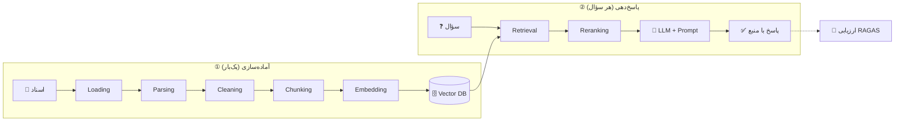

<div align="center">

# 🧠 RAG از صفر تا پیشرفته

### دوره‌ی متن‌باز و فارسی برای ساختن، سنجیدن و بهتر کردن سیستم‌های RAG

**یاد بگیر. کد بزن. اندازه بگیر. بهتر کن.**

[](https://github.com/HosseinHeydari2004/RAG-Tutorial-From-Zero-to-Advanced/stargazers)
[](https://github.com/HosseinHeydari2004/RAG-Tutorial-From-Zero-to-Advanced/network/members)
[](LICENSE)
[](https://www.python.org/)
[](CONTRIBUTING.md)

[🇬🇧 English](README.en.md) | **🇮🇷 فارسی**

[شروع سریع](#-شروع-سریع) •
[فهرست درس‌ها](#-فهرست-درسها) •
[نقشه راه](#-نقشه-راه) •
[مشارکت](#-مشارکت) •
[English](README.en.md)

</div>

---

<div dir="rtl">

## 🤔 این دوره دقیقاً چیست؟

مدل‌های زبانی بزرگ (LLM) چیزهایی را که بعد از زمان آموزششان اتفاق افتاده نمی‌دانند، به اسناد خصوصی تو دسترسی ندارند و گاهی با اطمینان کامل **چیزی از خودشان می‌سازند** (hallucination).

**RAG (Retrieval-Augmented Generation)** راه‌حل است: قبل از پاسخ دادن، مرتبط‌ترین بخش‌های اسناد تو را پیدا می‌کنیم و کنار سؤال به مدل می‌دهیم.

این ریپو یک مسیر کامل است، از «RAG یعنی چه؟» تا «یک سیستم ارزیابی‌شده و آماده‌ی استقرار». هر درس یک نوتبوک است که **همان‌جا اجرا می‌کنی و نتیجه را می‌بینی**.

```text
سؤال: «بعد از دو سال کار، چند روز مرخصی دارم؟»

بدون RAG  → «معمولاً ۱۰ تا ۲۰ روز...»            ❌ حدس
با RAG    → «۱۵ روز در سال (۱ تا ۳ سال سابقه)»  ✅ با ارجاع به صفحه‌ی سند
```

> این مثال از همین ریپو می‌آید: پروژه‌ی دوره روی یک «Employee Handbook» ساخته می‌شود و درس به درس به یک سیستم کامل تبدیل می‌شود. خروجی بالا برای توضیح ایده است؛ خروجی واقعی را خودت در درس‌ها می‌بینی.

---

## ✨ چرا این دوره؟

| | |
|---|---|
| 🇮🇷 **فارسی‌محور** | توضیح‌ها فارسی است و کد و اصطلاح‌ها انگلیسی، همان‌طور که در کار واقعی می‌بینی. چالش‌های متن فارسی (نرمال‌سازی، نیم‌فاصله، embedding چندزبانه) هم پوشش داده می‌شود. |
| 📏 **اول اندازه بگیر، بعد بهتر کن** | بخش ارزیابی (با RAGAS) *قبل از* درس‌های بهینه‌سازی می‌آید. هر تغییر، مثل chunk size یا reranker، با عدد سنجیده می‌شود، نه با حس. |
| 🧩 **یک پروژه که رشد می‌کند** | نه ده مثال بی‌ربط. یک سیستم، از اولین PDF تا deploy. |
| ⚡ **۲۰ خط تا اولین جواب** | درس صفر یک RAG کامل و کوچک است. اول نتیجه را می‌بینی، بعد باز می‌کنیم که داخلش چه خبر است. |
| 🆓 **مسیر رایگان** | هدف این است که هر درس‌ِ مبتنی بر LLM یک مسیر رایگان و لوکال هم داشته باشد، تا نبودن API پولی مانع یادگیری نشود. |
| 🔁 **قابل‌اجرا روی ماشین تمیز** | نسخه‌ی کتابخانه‌ها مشخص است و هر درس قابل‌اجرا روی Colab. |

---

## 🗺️ نمای کلی: RAG چطور کار می‌کند؟



---

## 🚀 شروع سریع

### گزینه ۱: بدون نصب، روی Colab
در جدول درس‌ها روی دکمه‌ی **Open in Colab** درس موردنظر بزن.

### گزینه ۲: روی کامپیوتر خودت

```bash
# ۱) کلون
git clone https://github.com/HosseinHeydari2004/RAG-Tutorial-From-Zero-to-Advanced.git
cd RAG-Tutorial-From-Zero-to-Advanced

# ۲) محیط مجازی
python -m venv .venv
source .venv/bin/activate        # ویندوز: .venv\Scripts\activate

# ۳) نصب
pip install -r requirements.txt

# ۴) اجرا
jupyter lab
```

> 🔑 **کلید API:** هیچ‌وقت داخل نوتبوک یا ریپو ذخیره نمی‌شود. درس‌هایی که لازم دارند، آن را با `getpass` یا متغیر محیطی از تو می‌گیرند.

---

## 📚 فهرست درس‌ها

**راهنمای وضعیت:** ✅ آماده • 🚧 در حال بازنویسی/نوشتن • 📅 برنامه‌ریزی‌شده

### سطح ۰: شروع

| # | درس | چه می‌سازی؟ | وضعیت |
|:-:|---|---|:-:|
| 00 | RAG در ۲۰ خط | اولین جواب از مدل با دانش بیرونی | 📅 |
| 01 | مفاهیم پایه | درک hallucination، context window، RAG در برابر fine-tuning | 📅 |

### سطح ۱: آماده‌سازی داده

| # | درس | چه می‌سازی؟ | وضعیت |
|:-:|---|---|:-:|
| 02 | [Loading](notebooks/02_loading.ipynb) | خواندن PDF و فایل‌ها به ساختار یکنواخت | 🚧 |
| 03 | [Parsing](notebooks/03_parsing.ipynb) | استخراج ساختار: عنوان، جدول، لیست | 🚧 |
| 04 | [Cleaning](notebooks/04_cleaning.ipynb) | حذف نویز و نرمال‌سازی متن | 🚧 |
| 05 | [Metadata](notebooks/05_metadata.ipynb) | برچسب‌گذاری برای فیلتر و ارجاع به منبع | 🚧 |
| 06 | [Chunking](notebooks/06_chunking.ipynb) | Fixed، Recursive، Token، Semantic، Document-based | 🚧 |

### سطح ۲: هسته‌ی RAG

| # | درس | چه می‌سازی؟ | وضعیت |
|:-:|---|---|:-:|
| 07 | Embedding | تبدیل متن به بردار | 📅 |
| 08 | انتخاب مدل embedding | مقایسه‌ی مدل‌های چندزبانه و فارسی | 📅 |
| 09 | Vector DB | ذخیره و جستجو با FAISS و Chroma | 📅 |
| 10 | Similarity و ایندکس | cosine، ANN، HNSW | 📅 |
| 11 | Retrieval پایه | top-k و metadata filtering | 📅 |
| 12 | Generation | prompt، ارجاع به منبع، «نمی‌دانم» گفتن | 📅 |
| 13 | RAG کامل | وصل‌کردن همه‌ی مراحل به یک pipeline | 📅 |

### سطح ۳: ارزیابی

| # | درس | چه می‌سازی؟ | وضعیت |
|:-:|---|---|:-:|
| 14 | اصول ارزیابی | recall@k، MRR و معیارهای generation | 📅 |
| 15 | دیتاست ارزیابی | ساخت سؤال و جواب مرجع | 📅 |
| 16 | RAGAS | faithfulness، relevancy، context precision و recall | 📅 |
| 17 | آزمایش A/B | سنجش اثر chunk size و embedding با عدد | 📅 |

### سطح ۴: بهبود Retrieval

| # | درس | چه می‌سازی؟ | وضعیت |
|:-:|---|---|:-:|
| 18 | Hybrid search | BM25 + vector | 📅 |
| 19 | Reranking | cross-encoder روی نتایج | 📅 |
| 20 | Query transformation | rewriting، multi-query، HyDE | 📅 |
| 21 | Context compression | فشرده‌سازی متن بازیابی‌شده | 📅 |
| 22 | Parent-child retrieval | chunk کوچک برای جستجو، بزرگ برای پاسخ | 📅 |

### سطح ۵: پیشرفته

| # | درس | چه می‌سازی؟ | وضعیت |
|:-:|---|---|:-:|
| 23 | Conversational RAG | حافظه‌ی چت و سؤال‌های پیرو | 📅 |
| 24 | Multimodal RAG | جدول و تصویر | 📅 |
| 25 | داده‌ی ساخت‌یافته | Text-to-SQL کنار RAG | 📅 |
| 26 | GraphRAG | گراف دانش | 📅 |
| 27 | Agentic RAG | routing، ابزار، خودتصحیحی | 📅 |
| 28 | امنیت و Guardrails | prompt injection و PII | 📅 |

### سطح ۶: Production

| # | درس | چه می‌سازی؟ | وضعیت |
|:-:|---|---|:-:|
| 29 | هزینه و سرعت | caching و batching | 📅 |
| 30 | Observability | tracing و لاگ | 📅 |
| 31 | Deploy | FastAPI + Docker | 📅 |
| 32 | به‌روزرسانی ایندکس | اضافه و حذف سند بدون ساخت مجدد | 📅 |
| 33 | مقیاس‌دهی | حجم بالا و انتخاب Vector DB | 📅 |

### 🏁 پروژه‌ی نهایی

| # | پروژه | وضعیت |
|:-:|---|:-:|
| 34 | یک سیستم RAG کامل روی داده‌ی واقعی، با ارزیابی و deploy | 📅 |

---

## 🎓 هر درس چه شکلی است؟

هر نوتبوک همین قالب را دارد، پس بعد از دو درس می‌دانی هر چیز کجاست:

```text
🎯 هدف  →  🧠 تئوری کوتاه  →  💻 کد قدم‌به‌قدم  →  ⚠️ اشتباه‌های رایج
   →  ✍️ تمرین  →  🔥 چالش  →  📌 خلاصه
```

- هر cell یک ایده دارد.
- تمرین‌ها جواب دارند (پوشه‌ی `solutions/`)، ولی اول خودت تلاش کن.
- در انتهای هر درس یک تست کوچک هست که نشان می‌دهد درس درست اجرا شده.

---

## 👤 این دوره برای کیست؟

**مناسب توست اگر:**
- Python بلدی و با LLM کار کرده‌ای یا کنجکاوی.
- می‌خواهی RAG را بفهمی، نه فقط از روی یک آموزش کوتاه کپی کنی.
- می‌خواهی بدانی چطور بفهمی سیستمت خوب است یا نه.

**پیش‌نیاز:** Python پایه (تابع، لیست، دیکشنری، کلاس ساده). به یادگیری ماشین قبلی نیازی نیست.

---

## 🧭 نقشه راه

- [ ] **v1.0:** درس ۰۰ تا ۱۳، یک RAG کامل و کارا
- [ ] **v1.1:** درس ۱۴ تا ۱۷، ارزیابی
- [ ] **v1.2:** درس ۱۸ تا ۲۲، بهبود Retrieval
- [ ] **v2.0:** درس ۲۳ تا ۳۴، پیشرفته، Production و پروژه‌ی نهایی

بر اساس بازخورد شما ترتیب و اولویت‌ها تغییر می‌کند. [در Issues نظر بده](../../issues).

---

## 📁 ساختار ریپو

```text
.
├── notebooks/     # درس‌ها (یک نوتبوک برای هر درس)
├── solutions/     # جواب تمرین‌ها
├── data/          # فایل‌های نمونه
├── src/           # کدهای مشترک بین درس‌ها
├── docs/          # مستندات تکمیلی
├── requirements.txt
└── README.md
```

---

## 🤝 مشارکت

این پروژه با کمک جامعه بهتر می‌شود. کار کوچک هم ارزشمند است:

- 🐛 غلط املایی، باگ کد یا توضیح گنگ پیدا کردی؟ یک [Issue](../../issues) باز کن.
- ✍️ تمرین یا چالش جدید داری؟ PR بده.
- 🌍 می‌خواهی درسی را ترجمه یا بازنویسی کنی؟ خوشحال می‌شویم.
- 💡 موضوعی هست که دوست داری آموزش داده شود؟ در Issues پیشنهاد بده.

راهنمای کامل در [CONTRIBUTING.md](CONTRIBUTING.md).

---

## ⭐ اگر مفید بود

- به ریپو **ستاره** بده، تا دیگران هم پیدایش کنند.
- به دوستی که دنبال یادگیری RAG است معرفی‌اش کن.
- بازخوردت را بنویس. می‌خواهیم بدانیم کجا گیر کردی.

---

## ❓ سؤال‌های پرتکرار

<details>
<summary><b>آیا حتماً باید API پولی داشته باشم؟</b></summary>

هدف دوره این است که هر درس‌ِ وابسته به LLM یک مسیر رایگان یا لوکال هم داشته باشد. جزئیات هر درس در همان نوتبوک آمده است.
</details>

<details>
<summary><b>به چه GPU یا سخت‌افزاری نیاز دارم؟</b></summary>

برای بیشتر درس‌ها فقط CPU یا Colab رایگان کافی است. اگر درسی نیاز خاصی داشته باشد، در ابتدای همان نوتبوک نوشته شده است.
</details>

<details>
<summary><b>چرا از LangChain استفاده می‌شود؟</b></summary>

برای کم‌کردن کد تکراری و تمرکز روی مفهوم. در درس‌های اصلی قبل از استفاده از هر abstraction توضیح می‌دهیم زیر آن چه اتفاقی می‌افتد.
</details>

<details>
<summary><b>درس‌ها کی کامل می‌شوند؟</b></summary>

نقشه‌ی راه بالا را ببین. درس‌ها به‌تدریج اضافه می‌شوند. برای خبردار شدن، ریپو را **Watch** کن.
</details>

---

## 👨‍💻 سازنده

**حسین حیدری** — دانشجوی مهندسی کامپیوتر، هم‌بنیان‌گذار و Technical Lead در **AI Builders Iran** (سازمان متن‌باز مهندسی هوش مصنوعی: Computer Vision، LLM، RAG و Agent).

[](https://www.linkedin.com/in/hossein-heydari2004)
[](https://github.com/HosseinHeydari2004)

## 📄 لایسنس

این پروژه تحت لایسنس [MIT](LICENSE) منتشر شده است.

</div>

---

## <a id="english-summary"></a>🌐 English Summary

**RAG: From Zero to Advanced** is a free, open-source, Persian-first course on Retrieval-Augmented Generation. It takes you from "what is RAG?" to an evaluated, deployable system through hands-on notebooks.

- 📚 A planned 35-lesson path: ingestion, embeddings, vector search, generation, **evaluation with RAGAS**, advanced retrieval, agentic RAG, and production
- 📏 *Measure first, then optimize*: evaluation comes before the tuning lessons
- 🧩 One project that grows lesson by lesson
- ⚡ Every lesson runs on Colab; Python 3.10+

**Quick start**

```bash
git clone https://github.com/HosseinHeydari2004/RAG-Tutorial-From-Zero-to-Advanced.git
cd RAG-Tutorial-From-Zero-to-Advanced
pip install -r requirements.txt
jupyter lab
```

Contributions, issues and feedback are very welcome. See [CONTRIBUTING.md](CONTRIBUTING.md). ⭐ Star the repo if it helps you!

👉 **Full English README:** [README.en.md](README.en.md)